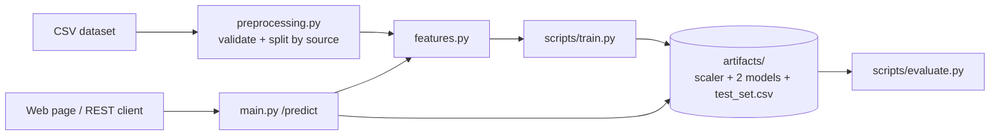

# ETI — Evaluating Translation Inaccuracies

ETI estimates the quality of a machine translation from linguistic and statistical features. It extracts features from a source sentence, its machine translation and a human reference, then predicts a 0–1 quality score with two TensorFlow models, **ETI-Baseline** and **ETI-5**.

**Status:** the code and sample data are illustrative. No trained weights, real dataset or accuracy figures are included, and this repository makes no performance claims. The 11,200-sample dataset from the original project description is not part of it.

## Problem

Judging machine translation by hand is slow. Reference-based metrics such as WER and TER are fast but only compare words. ETI combines several such signals into one learned quality estimate.

## Features

- CSV validation and cleaning (required columns, empty text, non-numeric or out-of-range scores).
- Features: source/translation length, length ratio, average word length, repetition (unique-token ratio), and, when a reference is given, WER, TER and length difference.
- Train/validation/test split by source sentence (no source appears in two splits); the scaler is fitted on training data only.
- `ETI-Baseline` (one hidden layer, 8 units) and `ETI-5` (four hidden layers, 64-32-16-8, plus the output layer), both Dense networks with a sigmoid output predicting `human_score`.
- Evaluation script reporting MAE, MSE and RMSE on the held-out test set.
- FastAPI service with a minimal web page, `/health`, `/predict` and `/docs`.

LEPOR is not implemented: no reliable maintained implementation was used, and a lookalike metric would be mislabelled. spaCy is not used because no feature needed it.

## Stack

Python 3.11, TensorFlow (CPU), scikit-learn, pandas, NumPy, sacrebleu (TER), FastAPI, Uvicorn, pytest, Docker, GitHub Actions.

## Architecture



## Structure

```text
app/        main.py (API), preprocessing.py, features.py, models.py, index.html
scripts/    train.py, evaluate.py
data/       sample_translations.csv (synthetic demo data)
tests/      test_preprocessing.py, test_features.py, test_api.py
artifacts/  generated models and report (git-ignored)
```

## Setup

Requires Python 3.11 (3.9–3.12 should work with TensorFlow 2.18).

```bash
python -m venv .venv
source .venv/bin/activate        # Windows: .venv\Scripts\activate
pip install -r requirements-dev.txt
```

All commands below run from the repository root.

## Workflows

| Task | Command | Needs |
|---|---|---|
| Run the app | `uvicorn app.main:app --reload` → http://127.0.0.1:8000 | Nothing; predictions need trained models |
| Compute metrics/features | `/predict` with a reference (or `app.features.extract_features`) | Nothing trained |
| Train | `python -m scripts.train` | A CSV with quality labels |
| Evaluate | `python -m scripts.evaluate` | Trained models (uses `artifacts/test_set.csv`) |

Without trained models the app still starts. `/predict` returns features only for requests without a reference, and HTTP 503 with training instructions for requests that need a prediction.

### Train

```bash
python -m scripts.train                          # bundled demo data
python -m scripts.train --data path/to/your.csv  # your own data
```

Training needs at least 30 valid rows and 10 distinct source sentences. Models, `scaler.joblib` and the held-out `test_set.csv` are saved in `artifacts/` (override with the `ETI_ARTIFACTS_DIR` environment variable). Results can differ slightly between platforms.

### Evaluate

```bash
python -m scripts.evaluate
```

Prints and saves `artifacts/evaluation_report.md` from the actual held-out predictions. It warns when the test set has fewer than 200 rows.

## API

```bash
curl -X POST http://127.0.0.1:8000/predict -H "Content-Type: application/json" \
  -d '{"source_text": "The cat sleeps.", "translated_text": "El gato duerme.", "reference_text": "El gato duerme."}'
```

Response shape (prediction values depend on your trained models):

```json
{
  "features": {"source_tokens": 3, "translation_tokens": 3, "length_ratio": 1.0, "avg_word_length": 3.667,
               "unique_token_ratio": 1.0, "wer": 0.0, "ter": 0.0, "reference_length_diff": 0},
  "predictions": {"ETI-Baseline": "<0-1>", "ETI-5": "<0-1>"},
  "interpretation": "<text>",
  "warnings": []
}
```

Status codes: 200 success, 422 blank or invalid text, 503 models not trained and a prediction is needed.

## Tests

```bash
python -m pytest
```

Tests need no network access, TensorFlow models or private data. API tests use a stub model.

## Docker

```bash
docker build -t eti .
docker run --rm -p 8000:8000 -v "$(pwd)/artifacts:/app/artifacts" eti
# train inside the container (writes to the mounted artifacts folder):
docker run --rm -v "$(pwd)/artifacts:/app/artifacts" eti python -m scripts.train
```

The server binds to `0.0.0.0:8000`. Models are not baked into the image; mount `artifacts/` as above. Windows PowerShell: use `${PWD}` instead of `$(pwd)`.

## Dataset schema

| Column | Description |
|---|---|
| `source_text` | Original sentence |
| `translated_text` | Machine translation to score |
| `reference_text` | Human reference translation |
| `human_score` | Quality label from 0 (bad) to 1 (perfect) |

`data/sample_translations.csv` has 40 English→Spanish rows (20 sources, two translations each). **Sentences, translations and `human_score` values are synthetic demonstration data written for this project, not human annotations.** Never report results from it as research results.

## Limitations

- WER and TER compare words with a reference; they cannot reliably detect meaning errors (negation, wrong numbers, antonyms). The demo data includes such cases on purpose.
- The tokenizer (`\w+`, lower-cased) suits space-separated languages. It is not suitable for Chinese, Japanese or Thai, and it splits Indic words at combining marks.
- The 0.4/0.7 bands in the interpretation text are arbitrary.
- Predictions need a reference; reference-free estimation is not implemented.
- With the demo data, the test split has 6 rows. Any evaluation on it is statistically meaningless.

Possible next steps: real labelled data, a reference-free model, embedding-based features (e.g. a multilingual sentence encoder), more language pairs.
